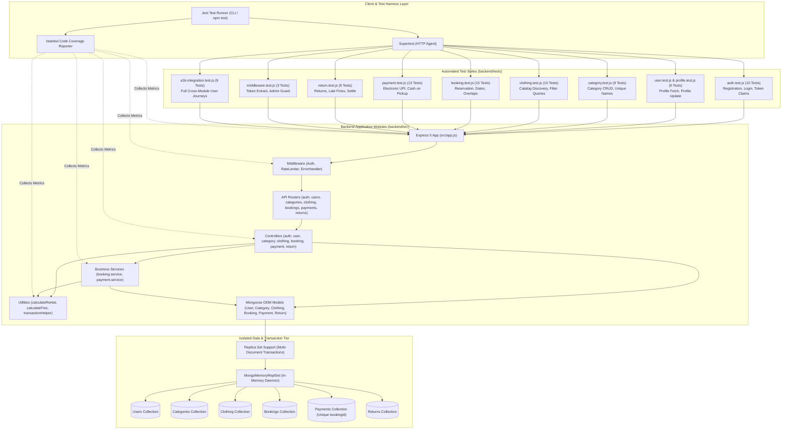

# Perfect Rent & Remind – Test Suite Architecture Diagram
**Course:** Advanced Web Technologies (AWT) – Practical 9  
**Application:** Perfect Rent & Remind – Smart Clothing Rental Management System  
**Test Harness:** Jest v30, Supertest v7, MongoMemoryReplSet v11  

---

## 1. Architectural Overview of Test Suites

The automated testing architecture for **Perfect Rent & Remind** is structured into a multi-tier hierarchy reflecting the Testing Pyramid:
1. **Tier 1: Unit & Domain Logic Testing:** Focuses on pure algorithmic calculations (`calculateRental.js`, `calculateFine.js`, `generateToken.js`, Joi schemas) without external I/O.
2. **Tier 2: Middleware & Security Boundary Testing:** Exercises token validation, role-based authorization guards (`protect`, `admin`), rate limiting, and centralized error handling in isolation.
3. **Tier 3: Domain Service & Concurrency Testing:** Validates transactional multi-document workflows, version-bump optimistic concurrency protocols, atomic inventory reservation, and rollback semantics in `booking.service.js` and `payment.service.js`.
4. **Tier 4: REST API Integration Testing:** Full HTTP request/response validation over Supertest across all functional domains (`/api/auth`, `/api/users`, `/api/categories`, `/api/clothing`, `/api/bookings`, `/api/payments`, `/api/returns`).
5. **Tier 5: System End-to-End Integration Testing:** Complete multi-step user journeys executing stateful lifecycles across bookings, atomic payments, cash collections, physical returns, and financial settlements.

---

## 2. Test Suite Architecture Diagram (Mermaid)

---

## 3. Test Suite Mapping & Execution Matrix

| Test Suite | Testing Level | Modules Covered | Primary Source Files Tested | Test Case IDs Covered | Execution Status |
|:---|:---:|:---|:---|:---|:---:|
| **Authentication & User Profile Suite** | Integration & Security | User onboarding, authentication, JWT tokens, profile editing | `src/controllers/auth.controller.js` `src/controllers/user.controller.js` `src/middleware/auth.middleware.js` | TC-01-P01 to P03 TC-01-N01 to N04 TC-02-N01 to N02 | **Pass** (19/19 tests) |
| **Category & Clothing Inventory Suite** | Integration & Contract | Inventory management, category CRUD, public search, query filtering | `src/controllers/category.controller.js` `src/controllers/clothing.controller.js` `src/models/Clothing.js` | TC-02-P01, TC-02-N03 TC-03-P01 to P03 TC-03-N01 to N04 | **Pass** (19/19 tests) *(Includes 4 passing 501 defensive guard tests)* |
| **Booking Lifecycle & Concurrency Suite** | Integration & Transaction | Date validation, rental calculations, inventory reservation, cancellation | `src/services/booking.service.js` `src/controllers/booking.controller.js` `src/utils/calculateRental.js` | TC-04-P01 to P03 TC-04-N01 to N04 TC-05-P01 to P02 TC-06-P01 to P03 | **Pass** (15/15 tests) *(Updated with dynamic future date fixtures)* |
| **Payment & Refund Transaction Suite** | Integration & Transaction | Electronic checkout, Cash on Pickup, atomic booking confirmation, refunds | `src/services/payment.service.js` `src/controllers/payment.controller.js` `src/models/Payment.js` | TC-07-P01 to P03 TC-08-P01 to P03 TC-09-P01, TC-09-N01 TC-10-P01, TC-10-N01 | **Pass** (13/13 tests) |
| **Return Processing & Settlement Suite** | Integration & Calculation | Return intake, calendar-day fine calculation, deposit deductions, completion | `src/controllers/return.controller.js` `src/utils/calculateFine.js` `src/models/Return.js` | TC-11-P01 to P03 TC-11-N01 to N03 TC-12-P01 to P02 TC-12-N01 to N03 | **Pass** (9/9 tests) |
| **Middleware & Rate Limiting Suite** | Unit & Middleware | Token extraction, role verification, rate limiting | `src/middleware/auth.middleware.js` `src/middleware/rateLimiter.middleware.js` | TC-02-N01 to N04 | **Pass** (3/3 tests) |
| **End-to-End System Integration Suite** | System / E2E | Cross-module customer & admin journeys from booking through settlement | Full application stack integrated (`app.js`, services, transactions) | All scenarios validated in sequence | **Pass** (8/8 tests) |

---

## 4. Key Architectural Patterns in Test Design
1. **Dynamic Ephemeral Data Isolation:** Each test suite boots an isolated in-memory MongoDB replica set via `MongoMemoryReplSet.create()`, ensuring zero database persistence between runs and preventing cross-suite data pollution.
2. **Atomic Transaction Simulation:** By leveraging `MongoMemoryReplSet`, the test suites execute genuine multi-document MongoDB transactions (`session.withTransaction()`), validating commit and rollback semantics under real database guarantees.
3. **Automated Teardown Fixtures:** Standardized `beforeEach` and `afterEach` hooks execute `deleteMany({})` across all collections, ensuring that individual test assertions begin with a pristine database state.
